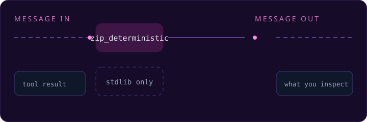

<p align="center">
  
</p>

<p align="center">
  <a href="https://pypi.org/project/zip-deterministic/"></a>
  <a href="https://pypi.org/project/zip-deterministic/"></a>
  <a href="https://pypi.org/project/zip-deterministic/"></a>
  <a href="https://github.com/sandeshbagmare/zip-deterministic/actions/workflows/ci.yml"></a>
  <a href="https://github.com/sandeshbagmare/zip-deterministic/blob/main/LICENSE"></a>
  <a href="https://sandeshbagmare.github.io/zip-deterministic/"></a>
  <a href="https://pypi.org/project/zip-deterministic/"></a>
</p>

<h3 align="center">byte-identical archives, build after build</h3>
<p align="center"><em>Standard library only. No runtime dependencies. Python 3.9+.</em></p>

<p align="center">
  
</p>

## Install

```console
pip install zip-deterministic
```

## Use

```python
from zip_deterministic import zip_bytes, tar_bytes, write_zip, write_tar

data = zip_bytes(
    {"README.md": b"# hello\n", "src/app.py": b"print('hi')\n"},
    compression=__import__("zipfile").ZIP_DEFLATED,
    level=6,
)

tar = tar_bytes({"README.md": b"# hello\n"})  # .tar.gz, gzip header cleared
plain = tar_bytes({"README.md": b"# hello\n"}, gz=False)  # bare .tar

write_zip("release.zip", {"a.txt": b"a"})  # returns the size in bytes
write_tar("release.tar.gz", {"a.txt": b"a"})
```

Executables keep their bit when you ask for it:

```python
zip_bytes({"bin/run.sh": b"#!/bin/sh\n"}, mode=0o755)
```

Members are checked before anything is written. Absolute paths, `..` traversal,
duplicate names and non-bytes content raise instead of producing an archive that
extracts outside the target directory.

## What it does not do

- It does not walk a directory for you: pass the members, so the caller decides what
  goes in and in what encoding.
- Symbols, hard links and directories are not modelled; only regular file members.
- Deflate output still depends on the zlib version. Same interpreter and zlib, same
  bytes; across zlib versions the compressed stream may differ, which is why the
  reproducible-builds project recommends `ZIP_STORED` when that matters.

## Development

```console
python -m venv .venv
.venv/bin/pip install -e ".[test]"
.venv/bin/pytest
```

## License

MIT.
